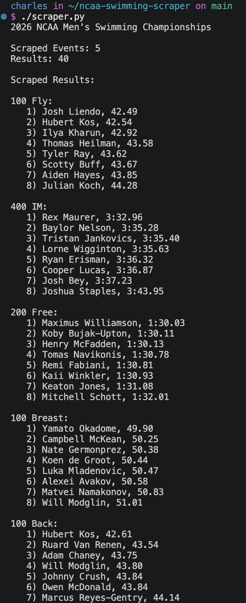

# NCAA Men's Swimming Results Scraper

This scraper collects finalist names and final times from five individual events at the [2026 NCAA Division I Men's Swimming and Diving Championships](https://swimmeetresults.tech/NCAA-Division-I-Men-2026/). It prints each event's results in finish order.

## Requirements

- Python 3
- The `requests` library

## How to use

From the project directory, install the dependency and run the scraper:

```bash
python3 -m pip install requests
python3 scraper.py
```

The program fetches the five event pages and prints the extracted finalists and times to standard output. Each request has a 10-second timeout, and at most four requests are active at once.

Example output:

```text
2026 NCAA Men's Swimming Championships

Scraped Events: 5
Results: 40

Scraped Results:

100 Back:
   1) Hubert Kos, 42.61
   2) Ruard Van Renen, 43.54
   ...
```

## Functional programming and performance

The scraper uses `filter()` to remove incomplete records and `map()` to reformat swimmer names. These functional transformations make the data-processing steps concise and composable; they are used for clarity, not as a claim that functional programming automatically makes the program faster.

The scraper uses `concurrent.futures.ThreadPoolExecutor` with four workers to request event pages concurrently. Since web requests spend much of their time waiting for responses, overlapping those waits can reduce the total time compared with requesting each page sequentially. The actual benefit depends on network and server response times. This program does not run a timing benchmark or claim a measured speedup.

## Screenshot



Replace `screenshot.png` with a screenshot of `python3 scraper.py` running in a terminal before submitting. The current file is an empty placeholder, so a real screenshot still needs to be captured.

## Data source

[2026 NCAA Division I Men's Swimming and Diving Championships results](https://swimmeetresults.tech/NCAA-Division-I-Men-2026/)
